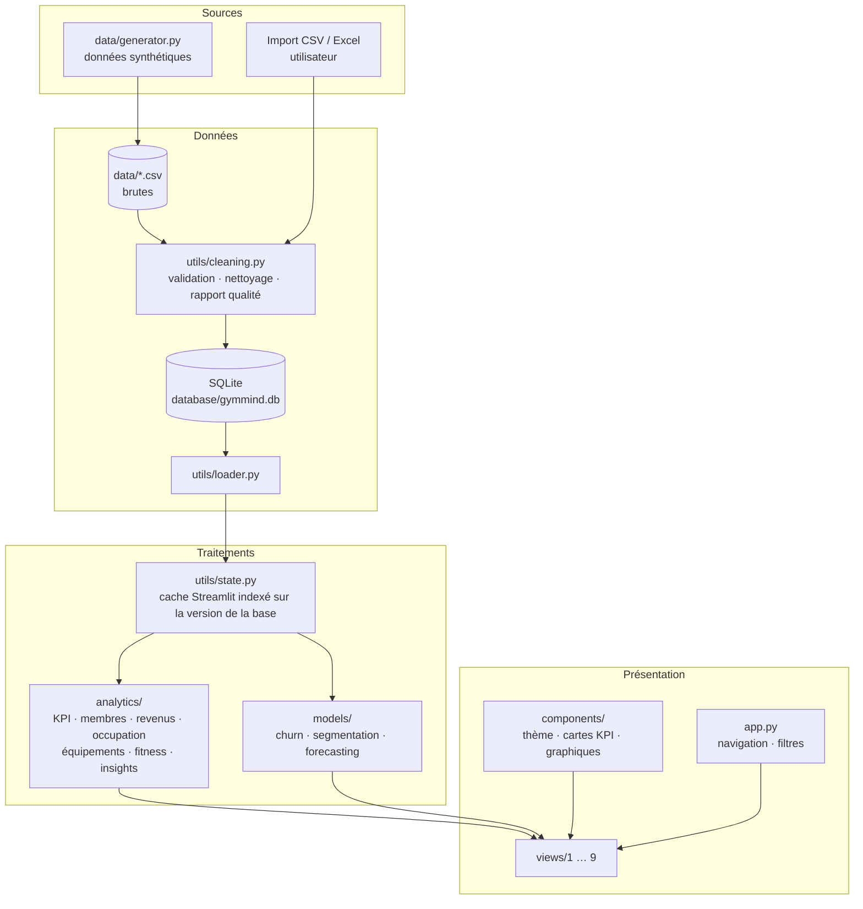
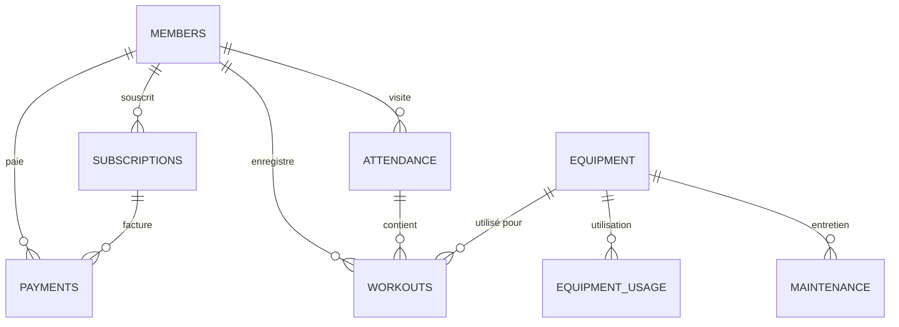

<!--
  RAPPORT DE PROJET — GYMMIND 360
  Les champs entre crochets [ ... ] de la page de garde sont à compléter.
  Les emplacements de captures d'écran sont signalés par « 📷 FIGURE ».
-->

<div align="center">

**[NOM DE L'UNIVERSITÉ]**
**[Faculté / Département]**
**[Intitulé de la formation — ex. Master Informatique, parcours Data Science]**

<br>

[Logo de l'université]

<br><br>

# GYMMIND 360
## Smart Gym Business Intelligence

### Plateforme d'informatique décisionnelle et d'analyse prédictive pour salles de sport

<br>

**Rapport de projet universitaire**

<br>

| | |
|---|---|
| **Réalisé par** | [Prénom NOM] — [Numéro étudiant] |
| | [Prénom NOM] — [Numéro étudiant] *(le cas échéant)* |
| **Encadré par** | [Titre Prénom NOM] — [Fonction / Laboratoire] |
| **Module / Unité d'enseignement** | [Intitulé du module] |
| **Année universitaire** | [2026 – 2027] |
| **Date de soumission** | [JJ/MM/AAAA] |

</div>

---

## Table des matières

1. [Résumé et mots-clés](#1-résumé-et-mots-clés)
2. [Introduction générale et objectifs du projet](#2-introduction-générale-et-objectifs-du-projet)
3. [Problématique et solution proposée](#3-problématique-et-solution-proposée)
4. [Analyse des besoins et spécifications fonctionnelles](#4-analyse-des-besoins-et-spécifications-fonctionnelles)
5. [Technologies utilisées](#5-technologies-utilisées)
6. [Architecture du système](#6-architecture-du-système)
7. [Base de données et description des données](#7-base-de-données-et-description-des-données)
8. [Nettoyage et analyse des données avec Pandas](#8-nettoyage-et-analyse-des-données-avec-pandas)
9. [Modules du tableau de bord et explication des KPI](#9-modules-du-tableau-de-bord-et-explication-des-kpi)
10. [Modèles d'apprentissage automatique et évaluation](#10-modèles-dapprentissage-automatique-et-évaluation)
11. [Tests et résultats](#11-tests-et-résultats)
12. [Captures d'écran](#12-captures-décran)
13. [Limites et perspectives d'amélioration](#13-limites-et-perspectives-damélioration)
14. [Conclusion générale](#14-conclusion-générale)
15. [Références](#15-références)
16. [Annexes](#16-annexes)

> **Avertissement sur les données.** Toutes les données utilisées dans ce projet et citées dans ce rapport sont **synthétiques**. Elles ont été produites par un générateur pseudo-aléatoire reproductible (`data/generator.py`, graine 42). Elles ne proviennent d'aucune salle de sport réelle et ne concernent aucune personne réelle. Les noms, adresses électroniques et comportements des « adhérents » sont fictifs. Les résultats chiffrés présentés (indicateurs, performances des modèles) caractérisent donc le comportement du système sur ce jeu de démonstration, et non une réalité de terrain.

---

## 1. Résumé et mots-clés

### Résumé

Les salles de sport et centres de fitness génèrent quotidiennement des données variées : adhésions, passages au contrôle d'accès, paiements, maintenance des équipements, carnets d'entraînement. Ces données sont rarement exploitées pour le pilotage. Ce projet présente **GymMind 360**, une application d'informatique décisionnelle (*Business Intelligence*) développée en Python. Elle centralise ces données, les nettoie, les analyse et les restitue sous forme de tableaux de bord interactifs, complétés par des modèles d'apprentissage automatique et un moteur de recommandations explicables.

L'application s'appuie sur **Pandas** pour le traitement des données, **SQLite** pour la persistance, **Streamlit** et **Plotly** pour l'interface, et **Scikit-learn** pour la modélisation. Elle comprend neuf pages :
- tableau de bord exécutif ;
- intelligence adhérents ;
- analyse des revenus ;
- occupation de la salle ;
- intelligence équipements ;
- analyses prédictives ;
- recommandations automatiques ;
- performance sportive des adhérents (avec consentement) ;
- gestion des données.

Quatre modèles sont mis en œuvre :
- **Prédiction de l'attrition :** forêt aléatoire évaluée par validation temporelle, ROC-AUC = 0,794 contre 0,747 pour une régression logistique de référence.
- **Prévision du chiffre d'affaires :** régression Ridge, MAPE = 13,7 % contre 31,4 % pour une prévision naïve saisonnière.
- **Prévision de la fréquentation :** *Gradient Boosting* récursif, R² = 0,913 et MAPE = 6,2 %, légèrement moins performant que la référence naïve hebdomadaire (MAPE = 5,6 %).
- **Segmentation comportementale :** K-Means, k = 5, silhouette = 0,166.

L'évaluation repose sur un jeu de données **entièrement synthétique** couvrant 24 mois (1 344 adhérents, 155 753 visites). La validation logicielle comprend 45 tests automatisés, tous réussis.

**Mots-clés :** informatique décisionnelle, tableau de bord, indicateurs clés de performance, Pandas, Streamlit, Plotly, Scikit-learn, SQLite, prédiction de l'attrition, prévision de séries temporelles, segmentation K-Means, moteur de recommandations, salle de sport, données synthétiques.

### Abstract

*GymMind 360* is a Python Business Intelligence application for gyms and fitness centres. It integrates data cleaning (Pandas), persistence (SQLite), interactive dashboards (Streamlit, Plotly), machine-learning models (Scikit-learn: churn prediction, revenue and attendance forecasting, K-Means segmentation) and an explainable rule-based recommendation engine. All data are synthetic. The system is validated by 45 automated tests.

**Keywords:** business intelligence, dashboard, KPI, churn prediction, forecasting, clustering, Streamlit, Scikit-learn, synthetic data.

---

## 2. Introduction générale et objectifs du projet

### 2.1 Contexte

Le secteur du fitness repose sur un modèle économique d'abonnement. La rentabilité d'une salle dépend moins du nombre de nouvelles inscriptions que de la **rétention** des adhérents, de l'**utilisation effective** des installations et de la **maîtrise des coûts** (personnel, loyer, énergie, maintenance). Les gestionnaires disposent souvent des données nécessaires : logiciel de caisse, contrôle d'accès, fichiers de maintenance. Ces données restent cependant dispersées et sont rarement transformées en indicateurs exploitables.

L'informatique décisionnelle répond à ce besoin. Elle collecte, nettoie et consolide les données, calcule des indicateurs clés de performance (KPI) et les présente sous une forme qui facilite la décision. L'apprentissage automatique permet d'aller au-delà de la description du passé, en anticipant les résiliations, les revenus ou l'affluence.

### 2.2 Objectifs du projet

Le projet poursuit les objectifs suivants :

| N° | Objectif | Concrétisation dans le projet |
|---|---|---|
| O1 | Offrir une vue synthétique de la performance de la salle | Tableau de bord exécutif à 12 KPI comparés au mois précédent |
| O2 | Comprendre le comportement des adhérents | Module *Member Intelligence* : acquisition, rétention par cohorte, attrition, fréquence, segmentation |
| O3 | Analyser et optimiser les revenus | Module *Revenue Analytics* : revenus par mois, formule, moyen de paiement, segment ; dépenses ; marge |
| O4 | Analyser et anticiper l'occupation de la salle | Module *Smart Occupancy* : carte de chaleur jour × heure, heures de pointe et creuses, prévision horaire |
| O5 | Suivre l'état et l'usage des équipements | Module *Equipment Intelligence* : taux d'utilisation, maintenance, score de santé, alertes |
| O6 | Mettre en œuvre des modèles prédictifs évalués | Module *Predictive Analytics* : attrition, revenus, fréquentation, K-Means, avec métriques et référence |
| O7 | Produire des recommandations automatiques et justifiées | Module *Smart Insights* : moteur de règles explicables |
| O8 | Proposer un suivi sportif individuel respectueux de la vie privée | Module *Member Fitness*, limité aux adhérents consentants, sans visée médicale |
| O9 | Permettre l'utilisation de données réelles | Import CSV/Excel avec validation et nettoyage ; base SQLite |
| O10 | Garantir la qualité logicielle | Architecture modulaire, 45 tests automatisés |

### 2.3 Organisation du rapport

La section 3 expose la problématique et la solution retenue. La section 4 formalise les besoins. Les sections 5 et 6 présentent les technologies et l'architecture. Les sections 7 et 8 décrivent les données et leur traitement. La section 9 détaille les modules et les indicateurs. La section 10 présente les modèles d'apprentissage automatique et leur évaluation. La section 11 rend compte des tests. Les sections 12 à 14 regroupent les captures d'écran, les limites et la conclusion.

---

## 3. Problématique et solution proposée

### 3.1 Problématique

Un gestionnaire de salle de sport se pose typiquement les questions suivantes :

- Combien d'adhérents sont réellement actifs, et l'effectif progresse-t-il ?
- Quels adhérents risquent de résilier prochainement, et pourquoi ?
- Le chiffre d'affaires baisse-t-il, et quelle en est la cause (moins d'inscriptions, plus de résiliations, moins de ventes annexes) ?
- À quelles heures la salle est-elle saturée ou au contraire sous-utilisée ?
- Quels équipements sont peu utilisés, tombent souvent en panne ou n'ont pas été entretenus ?
- Quelles actions prioritaires engager ?

La problématique du projet peut donc se formuler ainsi :

> *Comment transformer des données opérationnelles hétérogènes et imparfaites d'une salle de sport en informations fiables, en prévisions évaluées et en recommandations explicables, au sein d'une application unique, interactive et accessible à un gestionnaire non spécialiste ?*

Cette problématique comporte plusieurs difficultés :
- la **qualité des données** : doublons, valeurs manquantes, montants invalides ;
- la **cohérence temporelle** des indicateurs : un adhérent « actif » s'évalue à une date donnée ;
- la **validité des modèles prédictifs** : éviter toute fuite d'information du futur vers le passé ;
- l'**explicabilité** des recommandations ;
- la **protection des données personnelles** pour le suivi sportif.

### 3.2 Solution proposée

GymMind 360 est une application web locale construite avec Streamlit. Elle s'articule autour d'une chaîne de traitement unique :

1. **Acquisition :** génération de données de démonstration ou import de fichiers CSV/Excel.
2. **Validation et nettoyage :** schéma par table, conversion de types, dédoublonnage, imputation et rapport de qualité.
3. **Persistance :** base SQLite.
4. **Analyse :** fonctions Pandas pures et testables, regroupées dans le paquet `analytics/`.
5. **Modélisation :** modèles Scikit-learn du paquet `models/`.
6. **Restitution :** pages Streamlit et graphiques Plotly, avec un moteur de recommandations qui explique chaque alerte.

Choix structurants :
- **Pas de service externe.** Toutes les données restent locales (CSV et SQLite).
- **Données synthétiques réalistes avec signaux connus.** Le générateur introduit volontairement des phénomènes identifiables : pics horaires, saisonnalité, attrition liée au désengagement, baisse de revenu récente, équipements défaillants. Il devient ainsi possible de vérifier que l'application détecte ce qui a été introduit (voir section 11).
- **Évaluation honnête des modèles.** Chaque modèle est comparé à une référence simple, et les prédictions sont visuellement distinguées des données réelles.

---

## 4. Analyse des besoins et spécifications fonctionnelles

### 4.1 Acteurs

| Acteur | Rôle |
|---|---|
| Gestionnaire / direction | Consulte les KPI, les analyses et les recommandations ; exporte des listes et rapports |
| Responsable technique | Consulte l'état des équipements et l'historique de maintenance |
| Analyste de données | Importe des données, contrôle leur qualité, interroge la base en SQL |
| Adhérent consentant (indirect) | Ses données d'entraînement alimentent le module de performance sportive |

> L'application ne comporte pas de gestion d'authentification ni de rôles. Tous les acteurs accèdent aux mêmes pages (voir section 13).

### 4.2 Exigences fonctionnelles

| Réf. | Exigence | Implémentation (fichier) | Statut |
|---|---|---|---|
| EF-01 | Afficher les KPI exécutifs avec comparaison au mois précédent | `views/1_Executive_Dashboard.py`, `analytics/kpis.py` | Réalisé |
| EF-02 | Filtrer les analyses par période et par type d'abonnement | `app.py` (barre latérale), `analytics/kpis.py::apply_filters` | Réalisé |
| EF-03 | Analyser inscriptions, durée d'adhésion, rétention, attrition, fréquence | `views/2_Member_Intelligence.py`, `analytics/members.py` | Réalisé |
| EF-04 | Segmenter les adhérents par apprentissage non supervisé | `models/segmentation.py` | Réalisé |
| EF-05 | Analyser les revenus (mois, formule, moyen de paiement, segment), le profit et la croissance | `views/3_Revenue_Analytics.py`, `analytics/revenue.py` | Réalisé |
| EF-06 | Analyser la fréquentation (heure, jour, pointe, creux, carte de chaleur, tendance) | `views/4_Smart_Occupancy.py`, `analytics/occupancy.py` | Réalisé |
| EF-07 | Prévoir la fréquentation future | `models/forecasting.py::attendance_forecast`, `hourly_forecast` | Réalisé |
| EF-08 | Analyser l'usage et la maintenance des équipements ; signaler ceux qui nécessitent une attention | `views/5_Equipment_Intelligence.py`, `analytics/equipment.py` | Réalisé |
| EF-09 | Prédire l'attrition, prévoir le revenu, évaluer les modèles | `models/churn.py`, `models/forecasting.py`, `views/6_Predictive_Analytics.py` | Réalisé |
| EF-10 | Générer des recommandations automatiques expliquées | `analytics/insights.py`, `views/7_Smart_Insights.py` | Réalisé |
| EF-11 | Suivi sportif individuel limité aux données volontairement fournies | `analytics/fitness.py`, `views/8_Member_Fitness.py` | Réalisé |
| EF-12 | Importer des fichiers CSV et Excel avec validation | `utils/cleaning.py`, `utils/loader.py::import_table`, `views/9_Data_Management.py` | Réalisé |
| EF-13 | Afficher un rapport de qualité des données | `utils/cleaning.py::QualityReport`, page *Data Management* | Réalisé |
| EF-14 | Interroger la base en lecture seule (SQL) | `database/db.py::query` | Réalisé |
| EF-15 | Exporter des résultats (CSV, Markdown) | boutons de téléchargement (pages 3, 6, 7, 9) | Réalisé |
| EF-16 | Régénérer le jeu de démonstration | page *Data Management*, `data/generator.py` | Réalisé |

### 4.3 Exigences non fonctionnelles

| Réf. | Exigence | Mise en œuvre |
|---|---|---|
| ENF-01 | Interface professionnelle, thème sombre bleu marine avec accents violet et turquoise | `components/theme.py` (CSS, gabarit Plotly), `.streamlit/config.toml` |
| ENF-02 | Mise en page adaptative | colonnes Streamlit en mode *wide*, règles CSS `@media (max-width: 640px)` |
| ENF-03 | Code modulaire et maintenable | séparation données / analyse / modèles / composants / vues |
| ENF-04 | Réactivité | mise en cache (`st.cache_data`, `st.cache_resource`) indexée sur la version de la base |
| ENF-05 | Reproductibilité | générateur à graine fixe (42) ; `random_state=42` pour tous les modèles |
| ENF-06 | Fonctionnement hors ligne, sans API externe | CSV + SQLite locaux (seules les polices Google Fonts sont chargées en ligne, avec repli sur les polices système) |
| ENF-07 | Distinction claire entre données réelles et prédictions | conventions graphiques (section 10.6) et badge « Contains ML predictions » |
| ENF-08 | Respect de la vie privée et absence de diagnostic médical | filtre `data_consent`, avertissement explicite (section 9.8) |
| ENF-09 | Qualité vérifiée | 45 tests automatisés (`pytest`, `streamlit.testing`) |

### 4.4 Cas d'utilisation principaux

1. **Consulter la situation du mois.** Le gestionnaire ouvre le tableau de bord exécutif. Les KPI du dernier mois de la période sélectionnée sont comparés au mois précédent, et les trois recommandations prioritaires sont affichées.
2. **Préparer une campagne de rétention.** Dans *Predictive Analytics*, l'utilisateur filtre les adhérents à risque élevé et exporte la liste au format CSV, avec probabilité et facteurs de risque.
3. **Importer des données réelles.** Dans *Data Management*, l'utilisateur charge un fichier. La table cible est détectée automatiquement, les colonnes requises sont vérifiées et un rapport de qualité est affiché. La table est ensuite remplacée en base et tous les modules se recalculent.
4. **Planifier la maintenance.** Le responsable technique consulte la liste des équipements signalés et l'historique d'une machine.

---

## 5. Technologies utilisées

### 5.1 Pile technologique

Les versions indiquées sont celles installées dans l'environnement de développement (`.venv`). Le fichier `requirements.txt` fixe des versions minimales.

| Technologie | Version installée | Rôle dans le projet |
|---|---|---|
| **Python** | 3.14.0 | Langage de développement |
| **Pandas** | 3.1.1 | Chargement, nettoyage, agrégations, séries temporelles, tables pivot |
| **NumPy** | 2.5.4 | Calcul vectoriel (génération, occupation, métriques) |
| **Streamlit** | 1.67.0 | Application web, navigation multipage (`st.navigation`), widgets, cache, tests (`streamlit.testing`) |
| **Plotly** | 7.1.0 | Graphiques interactifs (barres, courbes, anneaux, cartes de chaleur, treemap, radar, jauges) |
| **Scikit-learn** | 1.9.1 | Forêt aléatoire, régression logistique, Ridge, Gradient Boosting, K-Means, PCA, métriques |
| **SQLite** | 3.50.4 (module `sqlite3`) | Base de données embarquée (`database/gymmind.db`) |
| **Matplotlib** | 3.11.2 | Rendu des figures statiques |
| **Seaborn** | 0.13.2 | Cartes de chaleur statiques : rétention par cohorte, matrice de confusion, corrélations |
| **openpyxl** | ≥ 3.1 | Lecture et écriture des fichiers Excel (import) |
| **joblib** | ≥ 1.4 | Parallélisation de la forêt aléatoire (`n_jobs=-1`) |
| **pytest** | ≥ 8.0 | Tests automatisés |

### 5.2 Justification des choix

- **Pandas** est la bibliothèque de référence pour la manipulation de données tabulaires en Python. Elle est utilisée dans toutes les couches : nettoyage, KPI et préparation des variables.
- **Streamlit** permet de construire une application web interactive entièrement en Python, sans développement front-end séparé. La navigation déclarative `st.navigation` organise les neuf pages en sections. Le module `streamlit.testing.v1.AppTest` permet de tester l'interface de façon automatisée.
- **Plotly** offre des graphiques interactifs (survol, zoom) avec un gabarit personnalisable. Un gabarit `gymmind` assure l'identité visuelle commune.
- **Scikit-learn** fournit des algorithmes éprouvés, une API homogène (`Pipeline`, `ColumnTransformer`) et les métriques d'évaluation nécessaires.
- **SQLite** est une base relationnelle sans serveur, stockée dans un fichier unique. Elle suffit pour un projet mono-utilisateur et peut être interrogée en SQL standard.

---

## 6. Architecture du système

### 6.1 Arborescence

```
gymmind360/
├── app.py                      # point d'entrée : thème, logo, navigation, filtres, initialisation des données
├── views/                      # une page par module (1 à 9), routées par st.navigation
├── components/                 # theme.py, kpi_cards.py, charts.py, layout.py, mpl.py
├── analytics/                  # features, kpis, members, revenue, occupancy, equipment, fitness, insights
├── models/                     # churn.py, segmentation.py, forecasting.py
├── data/                       # generator.py + 9 fichiers CSV générés
├── database/                   # db.py, schema.sql, gymmind.db
├── utils/                      # cleaning.py, loader.py, state.py, formatting.py
├── assets/                     # logo.svg, logo_full.svg
├── tests/                      # conftest + 4 fichiers de tests (45 tests)
├── .streamlit/config.toml      # thème Streamlit
├── requirements.txt
└── README.md
```

Volume de code source (lignes, fichiers Python) :

| Paquet | Lignes |
|---|---|
| `app.py` | 65 |
| `data/generator.py` | 459 |
| `database/` | 103 |
| `utils/` | 532 |
| `analytics/` | 953 |
| `models/` | 420 |
| `components/` | 484 |
| `views/` | 997 |
| `tests/` | 486 |
| **Total** | **≈ 4 500** |

### 6.2 Architecture en couches



| Couche | Responsabilité | Principe |
|---|---|---|
| Données | Génération, validation, nettoyage, persistance | Un schéma déclaratif par table (`SCHEMAS`) |
| Analyse | Calcul des indicateurs | Fonctions pures qui reçoivent et renvoient des `DataFrame`, sans dépendance à Streamlit, donc testables |
| Modèles | Apprentissage et évaluation | Objets résultats (`ChurnResult`, `SegmentationResult`, `ForecastResult`) qui regroupent modèle, métriques et sorties |
| État / cache | Accès aux données et modèles depuis l'interface | Clé de cache = version de la base (date de mise à jour la plus récente + nombre total de lignes) ; un import invalide automatiquement les caches |
| Présentation | Pages, composants visuels | Les pages ne contiennent pas de logique métier ; elles appellent `analytics`, `models` et `components` |

### 6.3 Flux d'exécution

1. `streamlit run app.py` configure la page, injecte le thème (CSS et gabarit Plotly) et affiche le logo.
2. Lors de la première session, `loader.bootstrap()` vérifie que la base contient les neuf tables. Sinon, il génère les CSV (ou les relit), les nettoie et les écrit dans SQLite.
3. `st.navigation` construit le menu en quatre sections : *Overview*, *Business Analytics*, *AI & Performance*, *Data*.
4. La barre latérale définit les filtres, mémorisés dans `st.session_state` : période (par défaut, les 12 derniers mois complets) et types d'abonnement.
5. La page sélectionnée lit les données via `utils/state.py`. Les tables, les modèles et les recommandations y sont mis en cache.

> **Remarque technique.** Les pages sont placées dans `views/` et non dans `pages/`. Pendant les tests, un dossier nommé `pages/` provoquait, lors d'un accès direct à l'URL d'une page sur un serveur fraîchement démarré, l'activation du mode multipage historique de Streamlit. La page s'exécutait alors sans `app.py`, donc sans thème ni navigation. Le renommage a corrigé ce comportement (section 11.4).

---

## 7. Base de données et description des données

### 7.1 Nature des données : un jeu entièrement synthétique

Les données sont produites par `data/generator.py`. Le générateur est **déterministe** pour une graine donnée, ce qu'un test vérifie (`test_generator_tables_and_reproducibility`).

| Paramètre | Valeur (code) |
|---|---|
| Période | du 1er novembre 2024 au 31 octobre 2026 (24 mois) |
| Graine | 42 |
| Horaires d'ouverture | 6 h – 23 h |
| Formules | Student 25 €, Basic 35 €, Standard 55 €, Premium 85 € par mois |
| Cycles de facturation | Mensuel (prix plein), Trimestriel (−5 %), Annuel (−15 %) |
| Base initiale | 380 adhérents inscrits entre juin 2022 et octobre 2024 (ceux ayant résilié avant la période sont exclus) |
| Nouvelles inscriptions | tirage de Poisson, environ 38 par mois × saisonnalité (janvier × 1,8 ; septembre × 1,5 ; décembre × 0,6) × légère tendance de croissance |

**Signaux volontairement introduits** (« vérité terrain » connue) :

| Signal | Mécanisme dans le générateur |
|---|---|
| Pics horaires | Créneaux préférés matin (≈ 7 h 20), midi (≈ 12 h 35) et soir (≈ 18 h 35) ; le week-end, fréquentation centrée sur ≈ 10 h 35 et ≈ 16 h 50 |
| Profil hebdomadaire | Poids lundi 1,25 … dimanche 0,55 |
| Saisonnalité | Fréquentation plus forte en janvier (× 1,25), plus faible en août (× 0,78) |
| Attrition liée à l'engagement | Probabilité de résiliation à chaque échéance croissante lorsque la fréquence de visite est faible ; plus élevée pour les formules mensuelles et sans renouvellement automatique |
| Désengagement avant résiliation | La fréquence de visite décroît linéairement jusqu'à 20 % de son niveau au cours des 75 jours précédant la résiliation |
| Baisse récente | Inscriptions du dernier mois × 0,55 ; probabilité de résiliation × 1,9 pour les échéances à partir du 15 septembre 2026 |
| Équipements | `EQ-RM-03` très peu utilisé ; `EQ-TR-02` sujet aux pannes (≈ 6,5 réparations par an) ; `EQ-LC-01` sans maintenance préventive depuis janvier 2026 |
| Données « sales » | 2 % d'âges et 1 % de genres manquants ; 1 % de moyens de paiement manquants ; 4 montants négatifs ; 0,5 % de paiements et 0,4 % de visites dupliqués |

> **Conséquence méthodologique.** Les paramètres du générateur ont été ajustés au cours du développement pour que les phénomènes soient détectables. Le premier calibrage produisait un lien trop faible entre engagement et attrition (ROC-AUC ≈ 0,68), et ce lien a été renforcé. Les performances des modèles reflètent donc la force des signaux introduits. Elles **ne constituent pas une estimation des performances attendues sur des données réelles**.

### 7.2 Volumétrie

| Table | Lignes (CSV brut) | Lignes (base, après nettoyage) |
|---|---|---|
| `members` | 1 344 | 1 344 |
| `subscriptions` | 9 551 | 9 551 |
| `attendance` | 156 376 | 155 753 |
| `payments` | 11 301 | 11 241 |
| `equipment` | 38 | 38 |
| `equipment_usage` | 27 740 | 27 740 |
| `maintenance` | 287 | 287 |
| `workouts` | 82 352 | 82 352 |
| `expenses` | 168 | 168 |

La base SQLite occupe environ 27 Mo.

### 7.3 Dictionnaire des données

**`members`** — adhérents (1 344 ; 845 actifs, 499 inactifs au 31/10/2026)

| Colonne | Type | Description |
|---|---|---|
| `member_id` | texte (clé) | Identifiant `M00001`… |
| `first_name`, `last_name`, `email` | texte | Identité fictive |
| `gender` | texte | Male / Female / Other (Unknown après imputation) |
| `age` | réel | Âge (18–72 ; 18–25 pour Student) |
| `join_date` | date | Date d'inscription |
| `membership_type` | texte | Student / Basic / Standard / Premium |
| `billing_cycle` | texte | Monthly / Quarterly / Annual |
| `auto_renew` | booléen | Renouvellement automatique (70,7 % des adhérents) |
| `data_consent` | booléen | Consentement au suivi sportif (343 adhérents) |
| `status` | texte | Active / Inactive |
| `churn_date` | date | Date de résiliation (vide si actif) |

**`subscriptions`** — périodes de facturation (8 207 renouvelées, 499 résiliées, 845 en cours)

| Colonne | Description |
|---|---|
| `subscription_id`, `member_id` | Identifiants |
| `membership_type`, `billing_cycle`, `price`, `auto_renew` | Conditions de la période |
| `start_date`, `end_date` | Bornes de la période |
| `status` | Renewed / Cancelled / Active |

**`attendance`** — passages : `visit_id`, `member_id`, `check_in`, `check_out`, `duration_min` (durée tirée selon une loi normale de moyenne 62 min, bornée entre 20 et 150 min).

**`payments`** — paiements : `payment_id`, `member_id`, `subscription_id`, `payment_date`, `amount`, `payment_method` (Credit Card, Direct Debit, Mobile Pay, Cash), `revenue_type` (Membership 9 317 ; Personal Training 1 012 ; Shop & Supplements 912), `membership_type`, `status` (Completed 10 909 ; Failed 204 ; Refunded 128).

**`equipment`** — 38 unités de 16 types : `equipment_id`, `name`, `equipment_type`, `category` (Cardio / Strength / Functional), `zone`, `brand`, `purchase_date`, `purchase_cost`, `service_interval_days`.

**`equipment_usage`** — usage quotidien par unité : `date`, `equipment_id`, `sessions`, `usage_minutes`. L'usage est nul les jours d'indisponibilité pour réparation.

**`maintenance`** — 233 interventions préventives et 54 réparations : `maintenance_id`, `equipment_id`, `date`, `maintenance_type`, `cost`, `downtime_hours`, `description`.

**`workouts`** — journal d'entraînement des 12 derniers mois pour les adhérents consentants (291 adhérents, 12 exercices) : `workout_id`, `visit_id`, `member_id`, `workout_date`, `exercise`, `exercise_type` (Strength / Cardio), `equipment_id`, `sets`, `reps`, `weight_kg`, `duration_min`, `distance_km`, `rpe` (effort perçu de 1 à 10).

**`expenses`** — dépenses mensuelles par catégorie : loyer, salaires, énergie, marketing, fournitures, logiciels et assurance, maintenance (cette dernière égale au coût de maintenance du mois). Colonnes : `expense_id`, `month`, `category`, `amount`.

### 7.4 Modèle relationnel



### 7.5 Implémentation SQLite (`database/db.py`)

- Les tables de données sont créées par `DataFrame.to_sql(..., if_exists="replace")` à partir des tables nettoyées. Les dates sont sérialisées au format `AAAA-MM-JJ HH:MM:SS`.
- La table technique `_metadata` (`schema.sql`) enregistre pour chaque table le nombre de lignes, la source (`demo`, `demo(seed=…)` ou `import:<fichier>`) et l'horodatage de mise à jour.
- Des index sont créés sur `member_id` et `equipment_id` lorsque ces colonnes existent.
- À la lecture (`read_table`), les colonnes de dates et de booléens sont reconverties d'après le schéma.
- L'explorateur SQL (`query`) n'accepte que les requêtes commençant par `SELECT` ou `WITH`. Surtout, il ouvre la base en **mode lecture seule** (`mode=ro`), si bien que SQLite rejette une requête `WITH … DELETE`.
- L'emplacement de la base est paramétrable par la variable d'environnement `GYMMIND_DB`, et celui des CSV par `GYMMIND_DATA_DIR`. Les tests utilisent ce mécanisme pour travailler sur une copie isolée.

---

## 8. Nettoyage et analyse des données avec Pandas

### 8.1 Schémas de validation

Le fichier `utils/cleaning.py` déclare pour chaque table un schéma (`SCHEMAS`) qui précise :
- les colonnes obligatoires ;
- la clé primaire ;
- les colonnes de type date, numérique ou booléen ;
- les règles d'imputation ;
- les colonnes devant être strictement positives.

Exemple pour `payments` : colonnes requises `member_id`, `payment_date` et `amount` ; clé `payment_id` ; `amount` strictement positif ; imputation `payment_method → "Unknown"`.

### 8.2 Chaîne de nettoyage (`clean_table`)

| Étape | Opération Pandas | Justification |
|---|---|---|
| 1. Normalisation des en-têtes | minuscules ; espaces et tirets remplacés par `_` | Accepter des fichiers dont l'en-tête est « Payment Date » |
| 2. Contrôle des colonnes requises | `validate_columns` | Arrêt avec un message explicite si une colonne manque |
| 3. Mesure des valeurs manquantes | `isna().sum()` sur les colonnes attendues | Calcul du taux de complétude |
| 4. Nettoyage des chaînes | suppression des espaces ; `""`, `"nan"` et `"None"` → valeur manquante | Homogénéiser les absences |
| 5. Conversion de types | `pd.to_datetime(errors="coerce")`, `pd.to_numeric(errors="coerce")` | Les valeurs invalides deviennent manquantes et sont comptées comme erreurs de type |
| 6. Conversion booléenne | correspondance yes/no/1/0/true/false/y/n | Formats d'export variés |
| 7. Dédoublonnage | `drop_duplicates()` puis sur la clé primaire ; pour `attendance`, sur (`member_id`, `check_in`) | Supprimer les doublons exacts et logiques |
| 8. Suppression des lignes invalides | `dropna(subset=requis)` ; montants ≤ 0 ; sortie antérieure à l'entrée | Données inexploitables |
| 9. Imputation | médiane (numérique) ou valeur explicite (`Unknown`, `Monthly`, `False`…) | Conserver les lignes sans biaiser fortement les distributions |
| 10. Rapport | `QualityReport` : lignes en entrée et en sortie, doublons, lignes invalides, valeurs imputées, erreurs de type, complétude | Traçabilité |

La fonction `guess_table` identifie la table cible d'un fichier importé. Elle retient la table dont au moins 60 % des colonnes obligatoires sont présentes dans le fichier.

### 8.3 Résultats du nettoyage sur le jeu de démonstration

Les chiffres suivants sont affichés par la page *Data Management* et obtenus par `loader.quality_reports_from_csv()` :

| Table | Lignes en entrée | Lignes en sortie | Doublons supprimés | Lignes invalides supprimées | Cellules manquantes | Valeurs imputées | Complétude |
|---|---|---|---|---|---|---|---|
| Members | 1 344 | 1 344 | 0 | 0 | 39 | 39 (âge 26, genre 13) | 99,68 % |
| Attendance | 156 376 | 155 753 | 623 | 0 | 0 | 0 | 100 % |
| Payments | 11 301 | 11 241 | 56 | 4 (montants négatifs) | 114 | 112 (moyen de paiement) | 99,86 % |
| Autres tables | — | identiques | 0 | 0 | 0 | 0 | 100 % |

Ces résultats correspondent au bruit introduit par le générateur (section 7.1). Un test automatisé le vérifie (`test_cleaning_removes_planted_noise`).

### 8.4 Principales analyses Pandas

| Analyse | Fonction | Techniques Pandas |
|---|---|---|
| Table mensuelle de pilotage | `kpis.monthly_table` | `groupby(dt.to_period("M"))`, `unstack`, `pct_change`, indicateurs calculés à une date donnée |
| Adhérents actifs à une date | `features.active_at` | masque booléen `join_date ≤ d` et (`churn_date` vide ou `> d`) |
| Rétention par cohorte | `members.cohort_retention` | regroupement par mois d'inscription, survie à M0…M12 |
| Fréquence de visite | `members.visit_frequency` | visites des 90 derniers jours normalisées par l'exposition, `pd.cut` en classes |
| Occupation simultanée | `occupancy.concurrency_matrix` | chevauchement vectorisé des intervalles entrée-sortie avec chaque heure, `np.bincount` par jour de semaine |
| Indicateurs équipements | `equipment.equipment_summary` | jointures, agrégations, `transform("median")` par type |
| Variables pour l'apprentissage | `features.member_features` | fenêtres glissantes de 30, 90 et 180 jours antérieures à la date d'observation |
| Progression sportive | `fitness.*` | `resample("W-MON")`, moyennes mobiles, estimation de la charge maximale |
| Filtres de l'interface | `kpis.apply_filters` | filtrage par période et formule ; répartition des dépenses |

**Répartition des dépenses sous filtre de formule.** Les dépenses sont communes à toute la salle. Lorsque l'utilisateur sélectionne une ou plusieurs formules, `allocate_expenses` attribue aux formules sélectionnées, pour chaque mois, une part des dépenses égale à leur part dans les adhérents actifs en fin de mois. La somme des parts allouées à chaque formule est égale au total, ce que vérifie `test_plan_filter_allocates_expenses`. Sans cette répartition, le revenu d'une seule formule était comparé aux coûts de toute la salle, d'où une perte fictive (section 11.4).

---

## 9. Modules du tableau de bord et explication des KPI

### 9.1 Éléments communs de l'interface

- **Thème :** fond bleu marine `#0B1020` en dégradé radial, accents violet `#8B5CF6` et turquoise `#22D3EE`, polices Inter et Space Grotesk.
- **Navigation :** quatre sections dans la barre latérale ; logo GymMind 360 en tête de la barre.
- **Filtres :** période et types d'abonnement. Ils s'appliquent aux modules descriptifs. Les modèles prédictifs et les recommandations utilisent toujours l'historique complet, comme l'indique un message dans la barre latérale.
- **Cartes KPI** (`components/kpi_cards.py`) : valeur, variation (en % ou en points de pourcentage pour les ratios), flèche colorée selon que la hausse est favorable ou non, et mini-courbe des 12 derniers mois.

### 9.2 Module 1 — Tableau de bord exécutif

Le mois de référence est le dernier mois de la période sélectionnée. Il est toujours comparé au **mois précédent réel**, même si celui-ci est hors de la période sélectionnée (`state.get_kpi_context`).

| KPI | Définition (code) | Valeur au 31/10/2026 (sans filtre de formule) |
|---|---|---|
| Total members | adhérents inscrits avant la fin du mois | 1 344 |
| Active members | inscrits et non résiliés à la fin du mois | 845 |
| Inactive members | total − actifs | 499 |
| Monthly revenue | somme des paiements au statut `Completed` du mois | 49 552 € |
| Renewal rate | renouvelées / (renouvelées + résiliées) parmi les périodes arrivant à échéance dans le mois | 91,6 % |
| Avg daily attendance | visites du mois / nombre de jours du mois | 323,4 |
| Monthly member growth | variation relative du nombre d'actifs | −1,7 % |
| Estimated profit | revenu − dépenses du mois (hors impôts et amortissements) | 18 409 € |
| Total expenses | somme des dépenses du mois | 31 143 € |
| Monthly churn rate | résiliations du mois / actifs en début de mois | 5,1 % |
| Revenue per member (ARPU) | revenu / actifs | 58,64 € |
| New registrations | inscriptions du mois | 29 |

Graphiques : revenus, dépenses et profit mensuels ; répartition des actifs par formule ; flux d'adhérents (nouveaux et résiliés) avec effectif actif ; tendance de fréquentation (moyenne glissante sur 28 jours) ; trois recommandations prioritaires avec un lien vers le module 7.

### 9.3 Module 2 — Intelligence adhérents

- **KPI :** inscriptions de la période, durée moyenne d'adhésion, attrition mensuelle moyenne, rétention à 6 mois, visites hebdomadaires moyennes.
- **Acquisition :** inscriptions par mois et formule ; profil âge × genre ; cycle de facturation par formule.
- **Rétention et attrition :** carte de chaleur Seaborn de rétention par cohorte. Sur les cohortes des 24 derniers mois, la rétention moyenne est de **76,6 % à 6 mois** et **60,9 % à 12 mois**. S'y ajoutent l'évolution des taux d'attrition et de renouvellement, et l'attrition par formule, cycle et renouvellement automatique.
- **Comportement :** distribution des visites hebdomadaires en classes (< 0,5 à 4+), distribution de la durée d'adhésion, boîtes à moustaches par formule.
- **Segmentation K-Means :** nombre de segments au choix (Auto, 3 à 7), projection ACP, tailles et profils des segments (section 10.4).

### 9.4 Module 3 — Analyse des revenus

- **KPI :** revenu total, profit estimé et marge, variation du dernier mois, ARPU, meilleur mois.
- Revenus mensuels empilés par source (abonnements, coaching personnel, boutique) avec la courbe de profit ; croissance mensuelle (barres vertes ou rouges) ; marge mensuelle.
- Revenus par formule, par moyen de paiement (anneau) et par segment K-Means.
- Dépenses par catégorie ; taux de paiements échoués.
- Tableau financier mensuel exportable en CSV.

Sur les 24 mois, le revenu encaissé s'élève à 927 196 € et les dépenses à 743 337 €.

### 9.5 Module 4 — Occupation de la salle

- **Carte de chaleur jour × heure** selon trois mesures au choix : personnes présentes (chevauchement des intervalles de présence), entrées par heure, ou taux d'occupation rapporté à une capacité paramétrée de 70 personnes (`GYM_CAPACITY`).
- **Heures de pointe et creuses.** Sur l'historique complet, l'heure de pointe est 19 h et l'heure la plus calme 22 h. Le créneau le plus chargé est le lundi à 19 h, avec 34,5 personnes en moyenne (49 % de la capacité).
- **Profil hebdomadaire** (visites moyennes par jour) : lundi 263,3 ; mardi 244,0 ; mercredi 244,9 ; jeudi 236,6 ; vendredi 205,0 ; samedi 183,4 ; dimanche 118,4.
- Tendance quotidienne avec moyennes glissantes sur 7 et 28 jours.
- **Prévision horaire des 7 prochains jours** (sortie de modèle, clairement signalée comme telle) : la prévision journalière est répartie selon le profil jour × heure des 12 dernières semaines.

### 9.6 Module 5 — Intelligence équipements

Indicateurs calculés par unité (`equipment_summary`) :

| Indicateur | Définition |
|---|---|
| Utilisation | minutes d'usage / (jours × 1 020 minutes d'ouverture) |
| Utilisation sur 30 jours | même calcul sur les 30 derniers jours |
| Ratio aux pairs | utilisation / médiane des unités du même type |
| Réparations sur 12 mois | nombre d'interventions de type `Repair` |
| Jours depuis l'entretien | jours écoulés depuis la dernière maintenance préventive |
| Disponibilité | 1 − heures d'arrêt / heures d'ouverture |
| Coût par heure d'usage | coût de maintenance / heures d'usage |
| **Score de santé (0–100)** | 100 − min(9 × réparations, 45) − 20 si entretien en retard − min(400 × (1 − disponibilité), 20) − min(1,5 × âge, 12) |

**Règles d'alerte :**
- entretien en retard de plus de 115 % de l'intervalle recommandé ;
- au moins 4 réparations sur 12 mois ;
- utilisation inférieure à 45 % de celle des pairs ;
- utilisation sur 30 jours supérieure à 60 %.

Le statut est *Critical* si le score est inférieur à 55, *Watch* si une alerte est levée, *Healthy* sinon.

Les trois unités introduites par le générateur sont détectées :

| Unité | Statut | Score | Utilisation | Réparations (12 mois) | Jours depuis l'entretien |
|---|---|---|---|---|---|
| Treadmill #2 (`EQ-TR-02`) | Critical | 28 | 29,5 % | 6 | 51 |
| Rowing Machine #3 (`EQ-RM-03`) | Watch | 68 | 1,4 % | 2 | 21 |
| Leg Curl Machine #1 (`EQ-LC-01`) | Watch | 70 | 8,0 % | 0 | 302 |

Pour l'ensemble du parc, l'utilisation moyenne est de 20,2 % et le score de santé moyen de 85,3/100. La page propose aussi un treemap de popularité, un nuage utilisation × coût de maintenance, les coûts mensuels de maintenance et une vue détaillée par unité (usage quotidien, interventions, jauge de santé).

### 9.7 Module 7 — Recommandations automatiques (*Smart Insights*)

Le moteur (`analytics/insights.py`) applique huit familles de règles indépendantes. Chaque recommandation (`Insight`) comprend :
- un titre ;
- une sévérité (*critical*, *warning*, *opportunity*, *positive*) ;
- une catégorie ;
- une métrique ;
- les éléments factuels ;
- l'explication de son déclenchement (règle, seuil, valeur observée) ;
- une action suggérée.

Les recommandations sont triées par sévérité puis par impact financier mensuel estimé. Si une règle échoue (par exemple parce qu'une colonne manque après un import), elle produit un avertissement au lieu de bloquer la page.

| Règle | Signal | Seuil |
|---|---|---|
| Risque d'attrition | part des actifs classés « High » par le modèle | ≥ 3 % (critique ≥ 8 %) |
| Adhérents dormants | actifs sans visite depuis 21 jours ou plus | ≥ 5 % |
| Tendance du revenu | variation mensuelle ; variation sur 3 mois glissants | ≤ −5 % (critique ≤ −10 %) ; ≤ −3 % ; positive si ≥ +5 % |
| Inscriptions | inscriptions du mois vs moyenne des 3 mois précédents | ≤ −25 % |
| Renouvellements | taux par cycle de facturation ; ratio d'attrition selon le renouvellement automatique ; taux global | −4 points vs global ; ≥ 1,5× ; < 90 % |
| Occupation | occupation simultanée maximale (12 dernières semaines) ; heures creuses en semaine | ≥ 70 % (avertissement ≥ 85 %) ; < 15 % |
| Équipements | sous-utilisation, entretien en retard, pannes répétées | voir section 9.6 |
| Coûts et paiements | dépenses sur 3 mois ; taux d'échec de paiement ; marge | ≥ +5 % ; ≥ 2 % ; ≥ 25 % (positif) |

**Recommandations produites sur le jeu de démonstration (10) :**

| Sévérité | Catégorie | Recommandation | Métrique |
|---|---|---|---|
| Critique | Rétention | Risque élevé de résiliation | 69 adhérents · 3 675 €/mois à risque |
| Critique | Équipements | Treadmill #2 tombe en panne de façon répétée | 6 réparations en 12 mois · 7 491 € |
| Avertissement | Revenus | Baisse du revenu par rapport à septembre | −5,9 % sur un mois |
| Avertissement | Croissance | Ralentissement des inscriptions | 29 inscriptions (−28,7 % vs moyenne sur 3 mois) |
| Avertissement | Équipements | Leg Curl Machine #1 : entretien en retard | 302 jours |
| Opportunité | Rétention | Les formules annuelles se renouvellent moins | 75,7 % vs 92,9 % global |
| Opportunité | Occupation | Affluence aux heures de pointe | 71 % de la capacité le lundi à 19 h |
| Opportunité | Occupation | Heures creuses en semaine | 4 heures sous 15 % d'occupation |
| Opportunité | Équipements | Rowing Machine #3 sous-utilisé | 1,4 % (12 % de ses pairs) |
| Positif | Revenus | Marge saine | 37,2 % |

Les recommandations sont exportables en CSV et en Markdown.

### 9.8 Module 8 — Performance sportive des adhérents

- Seuls les adhérents ayant `data_consent = True` **et** au moins une séance enregistrée sont listés (291). Un avertissement précise que les indicateurs sont des **indicateurs d'entraînement et non des évaluations médicales** ; aucun diagnostic n'est produit.
- Indicateurs :
  - nombre de séances ;
  - fréquence hebdomadaire ;
  - régularité (part des 12 dernières semaines comptant au moins 2 séances) ;
  - série de semaines consécutives ;
  - progression de force (pour chaque exercice pratiqué à au moins 4 dates : variation de la charge maximale estimée moyenne entre le premier et le dernier cinquième des enregistrements, puis moyenne sur les exercices) ;
  - exercice favori ;
  - volume total soulevé.
- Calendrier d'entraînement, séances par semaine (objectif de 2), volume hebdomadaire, progression par exercice : charge maximale estimée par la formule d'**Epley**, 1RM = charge × (1 + répétitions/30), pour la musculation ; allure en km/h pour le cardio.
- Distribution de l'effort perçu (RPE).

### 9.9 Module 9 — Gestion des données

1. **Vue d'ensemble :** contenu de `_metadata` et rapport de qualité.
2. **Import :** chargement CSV/Excel, détection de la table cible, aperçu, contrôle des colonnes requises, puis validation et import avec rapport.
3. **Explorateur SQL** en lecture seule, avec quatre requêtes d'exemple.
4. **Données de démonstration :** régénération avec une graine au choix et téléchargement de modèles CSV pour chaque table.

---

## 10. Modèles d'apprentissage automatique et évaluation

### 10.1 Variables communes : instantanés sans fuite d'information

`analytics/features.py::member_features(T, as_of)` calcule, pour chaque adhérent actif à une date d'observation `as_of`, des variables construites **uniquement** à partir des données antérieures à cette date :

| Variable | Description |
|---|---|
| `tenure_days` | ancienneté |
| `visits_30`, `visits_90` | visites sur les 30 et 90 derniers jours |
| `visits_per_week` | visites sur 90 jours normalisées par l'exposition |
| `visit_trend` | (visites sur 30 jours + 0,5) / (visites sur 90 jours / 3 + 0,5) : une valeur inférieure à 1 indique un ralentissement |
| `recency_days` | jours depuis la dernière visite (plafonné à 180) |
| `avg_duration`, `weekend_share`, `avg_hour` | durée moyenne des séances, part des visites le week-end, heure habituelle (90 jours) |
| `monthly_fee`, `membership_type`, `billing_cycle`, `auto_renew`, `age` | caractéristiques contractuelles et démographiques |
| `extra_spend_90` | dépenses annexes (coaching, boutique) sur 90 jours |
| `days_to_renewal` | jours restant avant la fin de la période de facturation en cours |

### 10.2 Prédiction de l'attrition (`models/churn.py`)

**Formulation.** Classification binaire : l'adhérent, actif à la date `as_of`, résilie-t-il dans les **90 jours** suivants ?

**Construction de l'échantillon :**
- 12 dates d'observation espacées de 45 jours, du 25/03/2025 au 02/08/2026 ;
- adhérents ayant au moins 14 jours d'ancienneté ;
- 7 341 lignes adhérent × date au total, dont 9,4 % de cas positifs.

**Validation temporelle :**
- apprentissage sur les 11 premières dates (6 517 lignes) ;
- test sur la plus récente, le 02/08/2026 (824 adhérents).

Le modèle n'a donc jamais accès à la période de test.

**Modèle :** `Pipeline` composé de :
- `ColumnTransformer` (`StandardScaler` pour les variables numériques, `OneHotEncoder` pour la formule et le cycle de facturation) ;
- `RandomForestClassifier` (300 arbres, profondeur maximale 8, au moins 10 observations par feuille, `class_weight="balanced_subsample"`).

Le seuil de décision (0,612) maximise le F1 sur l'échantillon d'apprentissage. **Référence :** régression logistique pondérée sur les mêmes variables.

**Résultats sur l'échantillon de test :**

| Métrique | Forêt aléatoire | Régression logistique (référence) |
|---|---|---|
| ROC-AUC | **0,794** | 0,747 |
| PR-AUC | **0,396** | 0,367 |
| Exactitude | **0,863** | 0,829 |
| Précision | **0,441** | 0,330 |
| Rappel | **0,402** | 0,373 |
| F1 | **0,421** | 0,350 |

**Matrice de confusion (test) :**

| | Prédit : reste | Prédit : résilie |
|---|---|---|
| **Réel : reste** | 670 | 52 |
| **Réel : résilie** | 61 | 41 |

**Interprétation.**
- La forêt aléatoire dépasse la référence sur toutes les métriques.
- Avec 9,4 % de cas positifs, la PR-AUC (0,396) est environ quatre fois supérieure à celle d'un classement aléatoire, qui serait de l'ordre de 0,09 à 0,10.
- Le rappel reste modeste : 41 résiliations sur 102 sont détectées au seuil retenu. C'est un compromis : abaisser le seuil augmenterait le rappel au prix de davantage de fausses alertes.
- **Importance des variables :** visites sur 30 jours (0,184), jours avant échéance (0,184), visites par semaine (0,129), visites sur 90 jours (0,086), tendance de fréquentation (0,078) et récence (0,064). Le modèle retrouve donc les mécanismes introduits par le générateur : désengagement et résiliation à l'échéance.

**Utilisation.**
- Le modèle final est réentraîné sur l'ensemble des instantanés, puis appliqué aux 845 adhérents actifs au 31/10/2026.
- Classes de risque (bornes de probabilité −0,01 / 0,35 / seuil / 1,0) : 571 faible, 205 moyen, 69 élevé.
- Pour chaque adhérent, des « facteurs de risque » lisibles sont dérivés par règles :
  - fréquentation en baisse ;
  - absence depuis plus de 14 jours ;
  - moins d'une visite par semaine ;
  - renouvellement automatique désactivé ;
  - échéance mensuelle proche.

### 10.3 Prévision du chiffre d'affaires (`models/forecasting.py::revenue_forecast`)

- **Données :** 24 revenus mensuels.
- **Modèle :** régression `Ridge` (α = 1). Variables :
  - tendance (indice du mois) ;
  - deux harmoniques de Fourier annuelles ;
  - indicatrices janvier, septembre et été.
- **Validation :** les 6 derniers mois sont réservés au test. Référence : même mois de l'année précédente (naïve saisonnière).
- **Intervalle de prévision :** ±1,96 × max(RMSE de test, écart-type des résidus).

| Métrique (6 mois de test) | Ridge | Naïve saisonnière |
|---|---|---|
| MAE | **6 876 €** | 15 676 € |
| RMSE | **7 541 €** | 15 909 € |
| MAPE | **13,7 %** | 31,4 % |
| R² | −15,26 | −71,37 |

**Interprétation.** Le modèle divise l'erreur moyenne par plus de deux par rapport à la référence. Le R² est fortement négatif, car la variance du revenu sur les 6 mois de test est faible au regard de l'erreur : sur un horizon aussi court, le R² n'est pas une mesure pertinente. Pour cette raison, l'interface affiche MAE, RMSE et MAPE, mais pas le R², pour ce modèle. Les paiements trimestriels et annuels rendent le revenu mensuel irrégulier, d'où un intervalle large (environ ±14 800 €).

**Prévision à 6 mois (modèle réentraîné sur les 24 mois) :**

| Mois | Prévision | Intervalle à 95 % |
|---|---|---|
| Nov. 2026 | 55 543 € | 40 762 – 70 324 € |
| Déc. 2026 | 56 386 € | 41 605 – 71 167 € |
| Janv. 2027 | 63 674 € | 48 893 – 78 455 € |
| Févr. 2027 | 62 809 € | 48 028 – 77 591 € |
| Mars 2027 | 66 550 € | 51 768 – 81 331 € |
| Avr. 2027 | 68 378 € | 53 597 – 83 159 € |

Ces valeurs extrapolent une tendance linéaire estimée sur 24 mois seulement. Elles ne tiennent pas compte du ralentissement observé en octobre 2026, et doivent donc être interprétées avec prudence.

### 10.4 Prévision de la fréquentation (`models/forecasting.py::attendance_forecast`)

- **Modèle :** `GradientBoostingRegressor` (300 arbres, profondeur 3, taux d'apprentissage 0,05, sous-échantillonnage 0,9). Variables :
  - calendrier : jour de la semaine, week-end, jour du mois, sinus et cosinus annuels ;
  - historique : nombre de visites 7 et 14 jours plus tôt ; moyennes des 7 et 28 derniers jours.
- **Prévision récursive multi-pas :** chaque prévision alimente l'historique de la suivante. L'évaluation sur les 28 derniers jours est elle aussi récursive depuis la date de coupure, ce qui reproduit les conditions réelles d'utilisation.
- **Référence :** répétition de la dernière semaine observée.

| Métrique (28 jours de test) | Gradient Boosting | Naïve hebdomadaire |
|---|---|---|
| MAE | 18,5 visites | **16,8** |
| RMSE | 22,2 | **19,7** |
| MAPE | 6,2 % | **5,6 %** |
| R² | 0,913 | **0,931** |

**Interprétation.** Le modèle explique 91 % de la variance de la fréquentation quotidienne, mais **ne surpasse pas** la référence naïve sur ce jeu de données. La fréquentation synthétique suit en effet un rythme hebdomadaire très régulier, pour lequel répéter la semaine précédente est un prédicteur excellent à court terme. Deux variantes ont été essayées pendant le développement, sans amélioration : modélisation du rapport au niveau moyen, et mélange avec la référence. L'interface affiche ce constat explicitement. L'intérêt attendu du modèle porte sur des horizons plus longs, où la saisonnalité (janvier, septembre, été) et les variations d'effectif comptent davantage ; cela n'a pas été évalué quantitativement dans ce projet.

La prévision horaire répartit la prévision journalière selon le profil jour × heure des 12 dernières semaines.

### 10.5 Segmentation K-Means (`models/segmentation.py`)

- **Population :** adhérents actifs ayant au moins 21 jours d'ancienneté.
- **Variables standardisées (7) :**
  - visites par semaine ;
  - durée moyenne des séances ;
  - heure habituelle ;
  - part du week-end ;
  - ancienneté (mois) ;
  - valeur mensuelle (formule + dépenses annexes/3) ;
  - tendance de fréquentation.
- **Choix de k :** k est testé de 3 à 7. Le critère retient le plus petit k ≥ 4 dont la silhouette atteint au moins 95 % de la meilleure valeur, ou à défaut le k de silhouette maximale.
- **Nommage :** chaque segment reçoit le nom du trait standardisé le plus marqué de son centroïde (par exemple « Early Birds » pour une heure habituelle nettement plus précoce). Les noms sont uniques.

| k | Silhouette | Inertie |
|---|---|---|
| 3 | 0,147 | 4 599 |
| 4 | 0,148 | 4 176 |
| **5** | **0,166** | 3 786 |
| 6 | 0,150 | 3 516 |
| 7 | 0,161 | 3 216 |

Métriques pour k = 5 : silhouette 0,166 ; Davies-Bouldin 1,673 ; Calinski-Harabasz 108,7. Les deux premières composantes de l'ACP expliquent 34,7 % de la variance.

| Segment | Adhérents | Part | Visites/sem. | Heure habituelle | Ancienneté (mois) | Valeur mensuelle | Tendance |
|---|---|---|---|---|---|---|---|
| Evening Regulars | 296 | 36 % | 2,39 | 16,1 h | 11,3 | 50,6 € | 1,11 |
| Early Birds | 284 | 34 % | 2,63 | 10,2 h | 12,3 | 50,7 € | 1,06 |
| Premium Spenders | 118 | 14 % | 2,54 | 13,7 h | 14,1 | 128,5 € | 1,05 |
| Loyal Veterans | 89 | 11 % | 3,33 | 14,1 h | 39,6 | 65,1 € | 1,05 |
| Rising Engagement | 40 | 5 % | 3,39 | 12,7 h | 2,1 | 56,2 € | 2,28 |

**Interprétation.** Une silhouette de 0,166 indique une **structure de groupes faible** : les segments se chevauchent largement, ce qui est fréquent pour des données comportementales continues. Les segments restent interprétables et exploitables commercialement (horaires, valeur, ancienneté), mais il faut les considérer comme une partition utile de la population plutôt que comme des groupes naturellement séparés. Le module affiche aussi le revenu par segment et le risque d'attrition moyen prédit par segment.

### 10.6 Distinction entre données réelles et prédictions

| Élément | Convention |
|---|---|
| Données historiques | trait plein turquoise |
| Prévision | trait pointillé violet, intervalle à 95 % ombré, annotation « FORECAST → » et ligne verticale à la date de coupure |
| Rétro-prévision sur la période de test | pointillé ambre |
| Pages contenant des prédictions | badge « Contains ML predictions » ; légende explicative en tête du module 6 ; prévision horaire du module 4 sous-titrée « Model output — not observed data » |

---

## 11. Tests et résultats

### 11.1 Stratégie de test

Les tests sont écrits avec **pytest**. L'interface est testée avec **`streamlit.testing.v1.AppTest`**, qui exécute l'application sans navigateur et permet d'agir sur les widgets. Les tests qui modifient des données (import, régénération) s'exécutent sur une **copie isolée** de la base et des CSV, grâce aux variables d'environnement `GYMMIND_DB` et `GYMMIND_DATA_DIR`. Un contrôle effectué après exécution a confirmé que la base de l'application n'avait pas été modifiée (toutes les sources restent `demo`).

### 11.2 Inventaire des tests (45)

**`tests/test_data_pipeline.py` — chaîne de données (6 tests)**

| Test | Vérification |
|---|---|
| `test_generator_tables_and_reproducibility` | 9 tables ; volumétrie plausible ; même graine, même résultat |
| `test_cleaning_removes_planted_noise` | doublons supprimés ; identifiants uniques ; montants > 0 ; âges et moyens de paiement imputés ; types dates |
| `test_clean_table_report_and_bool_parsing` | rapport : 1 doublon, 1 erreur de type, 1 ligne invalide ; conversion des booléens |
| `test_missing_columns_detected` | colonne requise absente : rapport non valide |
| `test_guess_table` | détection de la table cible |
| `test_sqlite_roundtrip` | écriture puis lecture SQLite ; types restaurés ; métadonnées ; requête SQL |

**`tests/test_analytics_models.py` — analyses et modèles (15 tests)**

| Test | Vérification |
|---|---|
| `test_monthly_table_consistency` | revenu mensuel total = somme des paiements `Completed` ; profit = revenu − dépenses ; taux dans [0, 1] |
| `test_executive_kpis` | actifs + inactifs = total ; mini-courbes sur 12 mois |
| `test_filters_restrict_period_and_plan` | filtres de période et de formule |
| `test_member_analytics` | cohortes et fréquences valides |
| `test_occupancy_peaks_are_planted_hours` | heure de pointe parmi les créneaux introduits ; matrice 7 × 17 |
| `test_equipment_flags_planted_units` | détection des 3 unités introduites |
| `test_fitness_only_consenting` | seuls les adhérents consentants |
| `test_churn_model_quality` | ROC-AUC > 0,72 ; probabilités dans [0, 1] ; classes valides |
| `test_segmentation` | 3 ≤ k ≤ 7 ; noms de segments uniques ; silhouette dans [−1, 1] |
| `test_forecasts` | revenus : MAPE < référence ; fréquentation : R² > 0,7 et MAPE < 12 % |
| `test_insights_detect_planted_signals` | baisse de revenu et alertes des 3 équipements ; chaque recommandation possède une justification et une action ; aucune règle en erreur |
| `test_fitness_functions_for_every_consenting_member` | toutes les fonctions fitness pour les 291 adhérents et chacun de leurs exercices |
| `test_equipment_drilldown_every_unit` | 38 unités ; score dans [0, 100] ; utilisation dans [0, 1] |
| `test_monthly_table_single_month` | période d'un seul mois |
| `test_plan_filter_allocates_expenses` | somme des parts allouées = total ; part de la formule Student inférieure à 30 % |

**`tests/test_app_smoke.py` — rendu des pages (9 tests)** : chacune des 9 pages s'exécute sans exception.

**`tests/test_features.py` — fonctionnalités de l'interface (15 tests)**

| Test | Vérification |
|---|---|
| `test_filters_on_every_page` (×4) | 4 combinaisons de filtres (un mois ; historique complet ; formule Student sur 6 mois ; Premium + Basic) × 9 pages |
| `test_plan_filter_changes_kpis` | le KPI « Active members » sous filtre Student est égal au nombre de Students actifs calculé indépendamment |
| `test_occupancy_heatmap_modes` | 3 modes de la carte de chaleur |
| `test_segmentation_k_values` | k = 3, 4, 5, 6, 7 et Auto |
| `test_predictive_controls` | horizon de 3, 12 et 6 mois ; filtres de classes de risque ; bouton d'export |
| `test_insight_filters` | chaque catégorie et chaque sévérité ; boutons d'export |
| `test_equipment_drilldown_planted_units` | vue détaillée de 4 unités |
| `test_fitness_members_and_exercises` | 3 adhérents × tous leurs exercices |
| `test_sql_explorer` | 4 requêtes d'exemple ; `DELETE` et `WITH … DELETE` rejetées ; données intactes |
| `test_import_csv_xlsx_and_rejection` | CSV avec en-têtes reformatés et 7 doublons ; Excel ; fichier sans colonne requise rejeté ; 9 pages fonctionnelles après import |
| `test_regenerate_demo_data` | régénération avec la graine 7 ; métadonnées ; 9 pages fonctionnelles |
| `test_dashboard_link_to_insights` | lien du tableau de bord vers le module 7 |

### 11.3 Résultats

| Campagne | Résultat |
|---|---|
| Suite complète `python -m pytest tests -q` | **45 tests réussis, 0 échec** (durée mesurée : 245,9 s) |
| Vérification manuelle en navigateur réel (Microsoft Edge piloté par Playwright, script hors dépôt) | 9 pages ouvertes par la barre latérale : 0 exception, 0 erreur dans la console, 53 graphiques Plotly rendus ; sélection de la formule « Student » : actifs 845 → 124 |

> La vérification en navigateur a été réalisée pendant le développement à l'aide d'un script temporaire qui ne fait pas partie du dépôt. Elle n'est donc pas reproductible par `pytest`.

### 11.4 Anomalies détectées et corrigées grâce aux tests

| N° | Anomalie | Détection | Correction |
|---|---|---|---|
| 1 | Erreur de format du texte des barres horizontales (le libellé était formaté au lieu de la valeur) | Test de rendu des pages | `components/charts.py::bar` : formatage des valeurs |
| 2 | Pages affichées sans thème ni navigation lors d'un accès direct à l'URL sur un serveur fraîchement démarré | Captures en navigateur | Dossier `pages/` renommé en `views/` |
| 3 | KPI comparés au même mois (« +0,0 % ») lorsque la période ne couvre qu'un mois | Test de filtres (un mois) | Comparaison systématique avec le mois précédent réel (`state.get_kpi_context`) |
| 4 | Perte fictive (−27,7 k€) sous filtre « Student » : revenu d'une formule comparé aux dépenses de toute la salle | Vérification en navigateur | Répartition des dépenses au prorata des adhérents actifs (`allocate_expenses`) ; profit Student corrigé : −1 082 € |
| 5 | L'explorateur SQL « en lecture seule » acceptait `WITH … DELETE` | Revue de code et test | Connexion SQLite en mode `ro` |
| 6 | Libellé de recommandation au format « €-5,318 » | Revue visuelle | Format monétaire signé « −€5,318 » |

---

## 12. Captures d'écran

> Les emplacements ci-dessous sont à compléter avec des captures de l'application lancée par `streamlit run app.py`. Le fichier suggéré, la page et le contenu attendu sont indiqués pour chaque figure.

| Figure | Fichier suggéré | Page / contenu à capturer |
|---|---|---|
| 1 | `captures/01_dashboard.png` | Executive Dashboard : 12 cartes KPI et graphique revenus/dépenses |
| 2 | `captures/02_dashboard_priorites.png` | Executive Dashboard : flux d'adhérents et « Top priorities » |
| 3 | `captures/03_cohortes.png` | Member Intelligence, onglet *Retention & churn* : carte de chaleur des cohortes |
| 4 | `captures/04_segmentation.png` | Member Intelligence, onglet *Segmentation (K-Means)* : projection ACP et profils |
| 5 | `captures/05_revenus.png` | Revenue Analytics : revenus par source et profit, répartitions |
| 6 | `captures/06_occupation.png` | Smart Occupancy : carte de chaleur jour × heure et profil horaire |
| 7 | `captures/07_equipements.png` | Equipment Intelligence : tableau des alertes et utilisation par unité |
| 8 | `captures/08_churn.png` | Predictive Analytics, onglet *Churn prediction* : métriques, courbe ROC, matrice de confusion, importance des variables |
| 9 | `captures/09_prevision_revenus.png` | Predictive Analytics, onglet *Revenue forecast* : historique, rétro-prévision et prévision |
| 10 | `captures/10_prevision_frequentation.png` | Predictive Analytics, onglet *Attendance forecast* |
| 11 | `captures/11_insights.png` | Smart Insights : cartes de recommandations avec justification |
| 12 | `captures/12_fitness.png` | Member Fitness : calendrier, progression d'un exercice, avertissement de confidentialité |
| 13 | `captures/13_import.png` | Data Management : rapport de qualité et import d'un fichier |

📷 **FIGURE 1 — Tableau de bord exécutif**
``

📷 **FIGURE 2 — Recommandations prioritaires**
``

📷 **FIGURE 3 — Rétention par cohorte**
``

📷 **FIGURE 4 — Segmentation K-Means**
``

📷 **FIGURE 5 — Analyse des revenus**
``

📷 **FIGURE 6 — Occupation de la salle**
``

📷 **FIGURE 7 — Intelligence équipements**
``

📷 **FIGURE 8 — Prédiction de l'attrition**
``

📷 **FIGURE 9 — Prévision du chiffre d'affaires**
``

📷 **FIGURE 10 — Prévision de la fréquentation**
``

📷 **FIGURE 11 — Recommandations automatiques**
``

📷 **FIGURE 12 — Performance sportive (adhérent consentant)**
``

📷 **FIGURE 13 — Gestion et qualité des données**
``

> Pour activer une figure, créer le dossier `captures/` à côté de ce rapport, y enregistrer l'image et retirer les accents graves (`` ` ``) qui entourent la ligne ``.

---

## 13. Limites et perspectives d'amélioration

### 13.1 Limites

| Domaine | Limite |
|---|---|
| **Données** | Les données sont **entièrement synthétiques**, et le générateur a été calibré pour que les phénomènes soient détectables. Les performances des modèles et les recommandations n'ont pas été validées sur des données réelles. |
| Données | Le générateur repose sur des hypothèses simplificatrices : une formule fixe par adhérent (pas de changement de formule), pas de gel d'abonnement, pas de jours fériés ni de fermetures. |
| Prédiction de l'attrition | Le rappel est limité (40 % au seuil retenu). Le modèle ne fournit pas d'explication individuelle rigoureuse : les « facteurs de risque » sont des règles et non des contributions du modèle. |
| Prévision du revenu | La série ne compte que 24 points mensuels. La tendance est extrapolée linéairement et le R² sur 6 mois n'est pas interprétable. |
| Prévision de la fréquentation | Elle ne surpasse pas la référence naïve hebdomadaire sur ce jeu de données. Aucune variable externe (météo, vacances, événements). |
| Segmentation | Structure de groupes faible (silhouette 0,166) ; nommage automatique heuristique. |
| Recommandations | Les seuils sont fixés manuellement et ne sont pas calibrés sur des données réelles. L'impact financier n'est qu'une estimation grossière, utilisée pour le tri. |
| Indicateurs | Capacité de la salle (70) et horaires codés en dur ; profit estimé sans impôts ni amortissements ; dépenses réparties au prorata des actifs sous filtre de formule (hypothèse de coût par adhérent uniforme). |
| Interface | Interface en anglais (le rapport est en français) ; aucune authentification ni gestion des rôles ; usage mono-utilisateur. |
| Import | L'import remplace une table entière (pas d'ajout incrémental) et ne vérifie pas l'intégrité référentielle entre tables. |
| Fitness | La charge maximale (formule d'Epley) est une estimation d'entraînement, non validée individuellement. |
| Tests | Les tests en navigateur réel ne sont pas intégrés à la suite automatisée. Les seuils de performance testés (ROC-AUC > 0,72, etc.) sont propres au jeu synthétique. |

### 13.2 Perspectives

1. **Validation sur données réelles**, en partenariat avec une salle (données anonymisées), puis recalibrage des seuils de recommandation.
2. **Connecteurs** vers des logiciels de gestion de salle, de contrôle d'accès ou de paiement ; import incrémental et contrôle d'intégrité référentielle.
3. **Modélisation :**
   - analyse de survie (modèle de Cox, forêts de survie) pour l'attrition ;
   - explications individuelles (valeurs de Shapley) ;
   - modèles de séries temporelles dédiés (SARIMA, modèles additifs) ;
   - variables exogènes (vacances scolaires, météo) ;
   - évaluation sur plusieurs horizons.
4. **Suivi des modèles :** réentraînement planifié, suivi de la dérive, sauvegarde des modèles (joblib).
5. **Recommandations personnalisées et mesure de leur effet** (tests A/B des campagnes de rétention).
6. **Industrialisation :**
   - authentification et rôles ;
   - base PostgreSQL ;
   - conteneur Docker ;
   - déploiement ;
   - intégration continue exécutant les 45 tests.
7. **Internationalisation** de l'interface (français/anglais) et paramétrage de la capacité, des horaires et de la devise.
8. **Conformité RGPD** renforcée : registre des consentements, droit à l'effacement, pseudonymisation.

---

## 14. Conclusion générale

Ce projet a abouti à **GymMind 360**, une application d'informatique décisionnelle complète et fonctionnelle, dédiée aux salles de sport. Elle couvre l'ensemble de la chaîne de valeur de la donnée :
- génération ou import de données ;
- validation et nettoyage avec Pandas, avec un rapport de qualité traçable ;
- persistance dans SQLite ;
- calcul de KPI cohérents dans le temps ;
- visualisation interactive avec Streamlit et Plotly ;
- modélisation prédictive avec Scikit-learn ;
- recommandations automatiques explicables.

Sur le plan méthodologique, le projet met l'accent sur la **rigueur de l'évaluation** :
- variables construites sans information future ;
- validation temporelle ;
- comparaison systématique à une référence simple ;
- distinction visuelle entre données observées et prédictions.

Cette rigueur conduit à des résultats nuancés :
- la prédiction de l'attrition (ROC-AUC 0,794) et la prévision du revenu (MAPE 13,7 % contre 31,4 %) dépassent nettement leurs références ;
- la prévision de la fréquentation n'améliore pas la référence naïve hebdomadaire ;
- la segmentation présente une structure faible.

Ces constats sont présentés tels quels, dans le rapport comme dans l'application.

Sur le plan logiciel, l'architecture en couches sépare la logique métier, testable indépendamment, de l'interface. Les 45 tests automatisés couvrent la chaîne de données, les analyses, les modèles, le rendu des neuf pages et l'ensemble des interactions de l'interface. Ils ont permis de détecter et de corriger six anomalies, dont une erreur de calcul du profit sous filtre et une faille de l'explorateur SQL.

La principale limite tient à l'usage exclusif de **données synthétiques**. Le système démontre sa capacité à détecter des phénomènes connus, mais sa valeur opérationnelle reste à confirmer sur des données réelles. C'est la perspective prioritaire de ce travail.

---

## 15. Références

1. McKinney, W. (2010). *Data Structures for Statistical Computing in Python*. Proceedings of the 9th Python in Science Conference, 56–61.
2. Harris, C. R., Millman, K. J., van der Walt, S. J., et al. (2020). Array programming with NumPy. *Nature*, 585, 357–362.
3. Pedregosa, F., Varoquaux, G., Gramfort, A., et al. (2011). Scikit-learn: Machine Learning in Python. *Journal of Machine Learning Research*, 12, 2825–2830.
4. Hunter, J. D. (2007). Matplotlib: A 2D Graphics Environment. *Computing in Science & Engineering*, 9(3), 90–95.
5. Waskom, M. L. (2021). seaborn: statistical data visualization. *Journal of Open Source Software*, 6(60), 3021.
6. Streamlit Inc. *Streamlit documentation* (navigation multipage, mise en cache, `streamlit.testing`). https://docs.streamlit.io
7. Plotly Technologies Inc. *Plotly Python Graphing Library*. https://plotly.com/python/
8. SQLite Consortium. *SQLite documentation* (URI filenames, mode lecture seule). https://www.sqlite.org/docs.html
9. Breiman, L. (2001). Random Forests. *Machine Learning*, 45(1), 5–32.
10. Friedman, J. H. (2001). Greedy function approximation: A gradient boosting machine. *The Annals of Statistics*, 29(5), 1189–1232.
11. Hoerl, A. E., & Kennard, R. W. (1970). Ridge Regression: Biased Estimation for Nonorthogonal Problems. *Technometrics*, 12(1), 55–67.
12. MacQueen, J. (1967). Some methods for classification and analysis of multivariate observations. *Proceedings of the Fifth Berkeley Symposium on Mathematical Statistics and Probability*, 1, 281–297.
13. Rousseeuw, P. J. (1987). Silhouettes: a graphical aid to the interpretation and validation of cluster analysis. *Journal of Computational and Applied Mathematics*, 20, 53–65.
14. Davies, D. L., & Bouldin, D. W. (1979). A Cluster Separation Measure. *IEEE Transactions on Pattern Analysis and Machine Intelligence*, PAMI-1(2), 224–227.
15. Caliński, T., & Harabasz, J. (1974). A dendrite method for cluster analysis. *Communications in Statistics*, 3(1), 1–27.
16. Fawcett, T. (2006). An introduction to ROC analysis. *Pattern Recognition Letters*, 27(8), 861–874.
17. Hyndman, R. J., & Athanasopoulos, G. (2021). *Forecasting: Principles and Practice* (3e éd.). OTexts. https://otexts.com/fpp3/
18. Epley, B. (1985). *Poundage Chart*. Boyd Epley Workout. Lincoln, NE : Body Enterprises.
19. Kimball, R., & Ross, M. (2013). *The Data Warehouse Toolkit: The Definitive Guide to Dimensional Modeling* (3e éd.). Wiley.
20. Règlement (UE) 2016/679 du Parlement européen et du Conseil du 27 avril 2016 (Règlement général sur la protection des données — RGPD). *Journal officiel de l'Union européenne*, L 119.

---

## 16. Annexes

### Annexe A — Installation et lancement (Windows, PowerShell)

**Première installation :**
```powershell
cd C:\Users\hacha\gymmind360
py -3.14 -m venv .venv
.\.venv\Scripts\Activate.ps1
pip install -r requirements.txt
streamlit run app.py
```

**Lancements suivants :**
```powershell
cd C:\Users\hacha\gymmind360
.\.venv\Scripts\Activate.ps1
streamlit run app.py
```

L'application est accessible à l'adresse http://localhost:8501. Au premier lancement, les données de démonstration et la base SQLite sont créées automatiquement.

**Commandes complémentaires :**
```powershell
python -m data.generator          # régénérer les fichiers CSV de démonstration
python -m pytest tests -q         # exécuter les 45 tests (environ 4 minutes)
```

### Annexe B — Correspondance modules / fichiers

| Module | Page | Logique d'analyse | Modèles |
|---|---|---|---|
| 1. Executive Dashboard | `views/1_Executive_Dashboard.py` | `analytics/kpis.py`, `analytics/occupancy.py` | — |
| 2. Member Intelligence | `views/2_Member_Intelligence.py` | `analytics/members.py` | `models/segmentation.py` |
| 3. Revenue Analytics | `views/3_Revenue_Analytics.py` | `analytics/revenue.py` | `models/segmentation.py` (segments) |
| 4. Smart Occupancy | `views/4_Smart_Occupancy.py` | `analytics/occupancy.py` | `models/forecasting.py` |
| 5. Equipment Intelligence | `views/5_Equipment_Intelligence.py` | `analytics/equipment.py` | — |
| 6. Predictive Analytics | `views/6_Predictive_Analytics.py` | `analytics/features.py` | `models/churn.py`, `models/forecasting.py`, `models/segmentation.py` |
| 7. Smart Insights | `views/7_Smart_Insights.py` | `analytics/insights.py` | sorties de `models/churn.py` |
| 8. Member Fitness | `views/8_Member_Fitness.py` | `analytics/fitness.py` | — |
| 9. Data Management | `views/9_Data_Management.py` | `utils/cleaning.py`, `utils/loader.py`, `database/db.py` | — |

### Annexe C — Reproductibilité des chiffres du rapport

Les valeurs des sections 7 à 10 ont été obtenues sur la base de démonstration générée avec la graine 42 (environnement : Python 3.14.0, Pandas 3.1.1, Scikit-learn 1.9.1). Elles peuvent être retrouvées dans l'application : *Data Management* pour la qualité, *Executive Dashboard* avec la période se terminant le 31/10/2026 et sans filtre de formule pour les KPI, *Predictive Analytics* pour les modèles, *Smart Insights* pour les recommandations. Une autre version des bibliothèques ou une régénération avec une autre graine peut faire varier légèrement ces valeurs.
